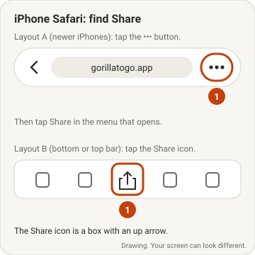
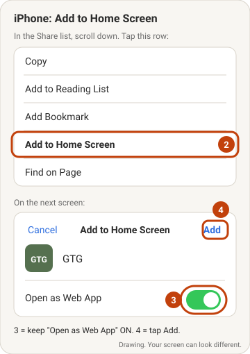
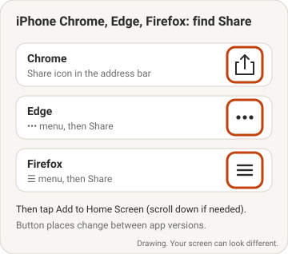
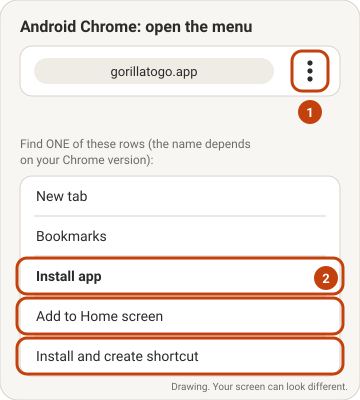
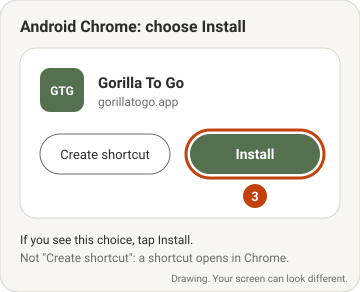
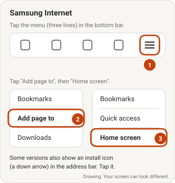
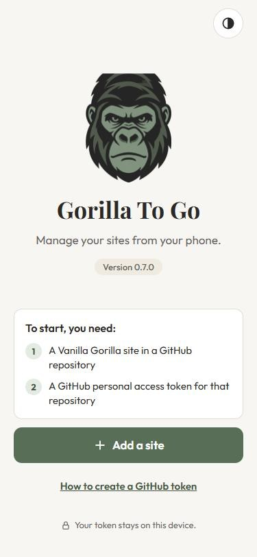
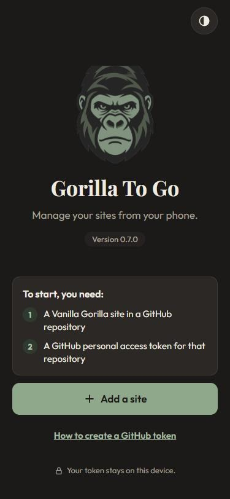

# Install Gorilla To Go on your phone

Gorilla To Go is a web app. You do not get it from the App Store or Google Play. You install it from your phone's web browser.

When you install it, Gorilla To Go:

- Gets its own icon on your home screen.
- Opens in its own window, without the browser's address bar.
- Opens even when you have no internet connection. (You need a connection to publish changes.)

The address of the app is **https://gorillatogo.app**

## Before you start

- Make sure your phone has an internet connection.
- **Install the app first. Then add your site.** On an iPhone, the browser and the installed app keep their data in different places. A site or token that you add in the browser does not move into the installed app.
- Do not use a private (incognito) window. A private window cannot install apps.

## Find your instructions

| Your phone | Your browser | Go to |
|---|---|---|
| iPhone | Safari | [iPhone with Safari](#iphone-with-safari) |
| iPhone | Chrome, Edge or Firefox | [iPhone with Chrome, Edge or Firefox](#iphone-with-chrome-edge-or-firefox) |
| Android | Chrome | [Android with Chrome](#android-with-chrome) |
| Android (Samsung) | Samsung Internet | [Android with Samsung Internet](#android-with-samsung-internet) |

If you do not know which browser you use, use **Safari** on an iPhone. Use **Chrome** on an Android phone.

---

## iPhone with Safari

These steps are for iOS 26 and later. For older iOS versions, see [Older iPhones](#older-iphones).

1. Open **Safari**.
2. Go to **https://gorillatogo.app**
3. Wait until the Gorilla To Go welcome screen shows.
4. Tap the **•••** (More) button next to the address bar.
   If your Safari has a toolbar at the bottom or the top, tap the **Share** icon instead (a box with an up arrow). Then go to step 6.
5. Tap **Share**.
6. Scroll down the list.
7. Tap **Add to Home Screen**.
8. Make sure **Open as Web App** is on (green).
9. Tap **Add**.

The Gorilla To Go icon is now on your home screen.

<!-- PHOTO-PLACEHOLDER: ../app/img/install/photo-ios-safari-more-button.png
     Real iPhone capture: Safari on gorillatogo.app with the ••• button visible. Replace the drawing below when ready. -->

<!-- PHOTO-PLACEHOLDER: ../app/img/install/photo-ios-add-to-home-screen.png
     Real iPhone capture: the Add to Home Screen screen with "Open as Web App" on. Replace the drawing below when ready. -->

### Older iPhones

On iOS 18 and earlier, the steps are almost the same:

1. Open **Safari**.
2. Go to **https://gorillatogo.app**
3. Tap the **Share** icon (a box with an up arrow) in the toolbar.
4. Scroll down the list.
5. Tap **Add to Home Screen**.
6. Tap **Add**.

Older iOS versions do not show **Open as Web App**. The icon opens as an app automatically.

---

## iPhone with Chrome, Edge or Firefox

You need iOS 16.4 or later.

1. Open your browser.
2. Go to **https://gorillatogo.app**
3. Wait until the Gorilla To Go welcome screen shows.
4. Find the **Share** button:
   - **Chrome:** tap the **Share** icon in the address bar.
   - **Edge:** tap the **•••** menu. Then tap **Share**.
   - **Firefox:** tap the **☰** menu. Then tap **Share**.
5. Scroll down the list.
6. Tap **Add to Home Screen**.
7. If you see **Open as Web App**, make sure it is on (green).
8. Tap **Add**.

These browsers move their buttons from time to time. If you cannot find **Add to Home Screen**, use Safari.

<!-- PHOTO-PLACEHOLDER: ../app/img/install/photo-ios-chrome-share.png
     Real iPhone capture: Chrome on iOS with the Share icon in the address bar. Replace the drawing below when ready. -->

---

## Android with Chrome

1. Open **Chrome**.
2. Go to **https://gorillatogo.app**
3. Wait until the Gorilla To Go welcome screen shows.
4. Chrome can show an **Install** message at the bottom of the screen. If you see it, tap **Install**. Then go to step 8.
5. Tap the **⋮** (three dots) menu at the top right.
6. Tap the install row. The name of this row changes with your Chrome version. It is one of these:
   - **Install app**
   - **Add to Home screen**
   - **Install and create shortcut**
7. If Chrome asks you to select **Install** or **Create shortcut**, tap **Install**.
8. Tap **Install** again if Chrome asks you to confirm.

The Gorilla To Go icon is now on your home screen and in your app list.

Do not select **Create shortcut**. A shortcut opens Gorilla To Go in Chrome, with the address bar.

<!-- PHOTO-PLACEHOLDER: ../app/img/install/photo-android-chrome-menu.png
     Real Android capture: Chrome's ⋮ menu open on gorillatogo.app, with the install row visible. Replace the drawing below when ready. -->

<!-- PHOTO-PLACEHOLDER: ../app/img/install/photo-android-chrome-install.png
     Real Android capture: the Install / Create shortcut choice. Replace the drawing below when ready. -->

---

## Android with Samsung Internet

1. Open **Samsung Internet**.
2. Go to **https://gorillatogo.app**
3. Wait until the Gorilla To Go welcome screen shows.
4. Look in the address bar for an install icon (a down arrow). If you see it, tap it. Then go to step 8.
5. Tap the **☰** (three lines) menu at the bottom right.
6. Tap **Add page to**.
7. Tap **Home screen**.
8. Tap **Add** or **Install**.

The Gorilla To Go icon is now on your home screen.

<!-- PHOTO-PLACEHOLDER: ../app/img/install/photo-samsung-menu.png
     Real Samsung capture: the ☰ menu with "Add page to" visible. Replace the drawing below when ready. -->

---

## After you install

This is the Gorilla To Go icon:

1. Go to your home screen.
2. Find the Gorilla To Go icon.
3. Tap the icon.
4. Make sure the app opens without the browser's address bar.
5. Tap **Add a site**.

You can close the browser tab. You do not need it again.

The welcome screen follows your phone's light or dark setting:

| Light | Dark |
|---|---|
|  |  |

## If something does not work

- **I cannot find "Add to Home Screen" or "Install":** make sure you are not in a private window. Make sure your browser is up to date. On an iPhone, try Safari.
- **The link opened inside another app** (for example Mail, Messages, Facebook or Instagram): those apps cannot install web apps. Copy the address. Open Safari (iPhone) or Chrome (Android). Paste the address.
- **The app opens with an address bar:** you made a bookmark or a shortcut, not an app. Remove the icon. Then do the install steps again. On an iPhone, make sure **Open as Web App** is on. On Android, select **Install**, not **Create shortcut**.
- **My site is not in the app after I installed it:** you added the site in the browser before you installed the app. Open the installed app. Add the site again.

## Remove the app

**Important:** when you remove the app, you also remove the data that Gorilla To Go keeps on your phone: your tokens, your list of sites and all changes that you did not publish. Publish your changes first.

**iPhone:**

1. Touch and hold the Gorilla To Go icon.
2. Tap **Delete Bookmark** (or **Remove App**).
3. Tap **Delete** to confirm.

**Android:**

1. Touch and hold the Gorilla To Go icon.
2. Tap **Uninstall** (or **Remove**).
3. Tap **OK** to confirm.

---

## iPhones and your data: the honest version

Maybe you heard that web apps on iPhones "forget things". That is partly true. This section tells you what can happen, why, and what you can do.

### What Gorilla To Go keeps on your phone

| Kept on your phone only | Kept safe on GitHub |
|---|---|
| Your GitHub tokens | Your published pages |
| Your list of sites | Your published photos |
| Changes that you did not publish (text and new photos) | Your site's settings and template |
| Your theme setting (light or dark) | |

**Your website is never at risk.** If your phone loses the Gorilla To Go data, your site stays the same. Only the items in the left column can be lost.

### What Apple does and does not promise

Apple does not promise that a web app keeps its data forever. The data stays most of the time, but there is no guarantee. These are the known causes of data loss on an iPhone:

1. **You do not install the app.** If you use Gorilla To Go in Safari (not from the home screen icon), Safari can delete its data after about 7 days without a visit. Installed web apps do not have this 7-day limit. **This is the most important reason to install the app.**
2. **Your iPhone is almost full.** When storage is low, iOS can delete website data to make space. It deletes the data of the sites you used least recently first.
3. **You delete the icon.** This deletes the app's data at the same time.
4. **You clear your website data** in **Settings**. This can also clear the data of installed web apps.
5. **You move to a new iPhone.** Do not expect web app data to move with a backup or a transfer. Plan to add your sites again on the new phone.

Some people also report data loss after an iOS update, with no clear cause. These reports are not common, and Apple does not explain them. We cannot promise that it will not happen to you.

### What Gorilla To Go does to help

- When it starts, Gorilla To Go asks iOS to keep its data permanently ("persistent storage"). iOS decides if it agrees. iOS is more likely to agree for an app that you installed on the home screen.
- Gorilla To Go saves your changes on the phone while you type, so a closed app does not lose your work.
- Gorilla To Go keeps only a copy of your page list on the phone. If the copy is lost, the app gets the list from GitHub again.

### What you can do

1. **Install the app.** Do not use it in a browser tab.
2. **Publish often.** A change is safe only after you tap **Publish**. Do not keep large changes on the phone for days.
3. **Keep free space on your iPhone.** Go to **Settings** > **General** > **iPhone Storage** to see how much space you have.
4. **Do not clear website data** in Settings unless you must.
5. **Know how to make a new token.** A new token takes about 5 minutes. See **How to create a GitHub token** in the app.

### If your data is gone

You will see the Gorilla To Go welcome screen again, with no sites. Do these steps:

1. Make a new GitHub token for each site. See **How to create a GitHub token**.
2. On GitHub, delete the old tokens that you do not use now.
3. In Gorilla To Go, tap **Add a site**.
4. Add each site with its new token.
5. We suggest you have a backup of your token somewhere safe (like in a password manager). While you can always create a new one, you can't recover one from GitHub after you've created it.

Your published pages and photos are still there. Changes that you did not publish are gone.

### What about Android?

Android phones delete web app data much less often. Chrome and Samsung Internet keep the data of installed apps unless the phone is very low on space, you clear the browser's data, or you uninstall the app. The advice above is good for Android too: install the app, and publish often.

---

### More information

These pages give the technical details (for readers who want them):

- [Turn a website into an app in Safari on iPhone](https://support.apple.com/guide/iphone/open-as-web-app-iphea86e5236/ios) (Apple Support)
- [Updates to Storage Policy](https://webkit.org/blog/14403/updates-to-storage-policy/) (WebKit, the engine of Safari)
- [Progressive web apps on iPhone in 2026: what is true and what is folklore](https://synthetixis.com/writing/pwa-ios-2026) (Synthetixis)
